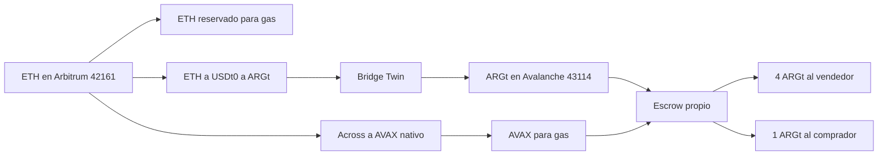

# Obra Clara

Plataforma para compras de construcción, gestión de proyectos y seguimiento de pagos protegidos contra entrega.

## Aplicaciones publicadas

- Compras: https://obra-clara-comprador.vercel.app
- Ventas: https://obra-clara-proveedor.vercel.app
- Servicio compartido: https://obra-clara-gray.vercel.app/api/demo

## Desarrollo

Requiere Node.js 24 y pnpm.

```sh
pnpm install --frozen-lockfile
pnpm dev
pnpm build
```

Copiar `.env.example` a `.env.local` y completar únicamente las variables necesarias para el entorno. Nunca versionar tokens ni archivos `.env.local`.

## Configuración de las aplicaciones

El mismo código se publica en tres proyectos Vercel. El comprador utiliza `NEXT_PUBLIC_OC_ROLE=buyer`; el proveedor utiliza `NEXT_PUBLIC_OC_ROLE=provider`. Ambos apuntan `NEXT_PUBLIC_OC_SHARED_API` al servicio compartido.

El proyecto que sirve `/api/demo` utiliza Vercel Blob privado con `BLOB_READ_WRITE_TOKEN`, configurado exclusivamente como variable de servidor. Los registros se aíslan por workspace y se actualizan con control de concurrencia e idempotencia.

## Funcionalidades

- Marketplace de materiales y equipamiento, proveedores, filtros, favoritos y carrito mixto por proyecto.
- Proyectos con datos de recepción, logística, presupuestos, gráficos y gastos por fecha y proveedor.
- Órdenes, entregas parciales, documentación con QR, inventario y movimientos.
- Fondos, reservas, anticipos, aprobaciones, conciliación e historial.
- Interfaz de ventas con productos, stock, órdenes y comprobantes.
- Brick con historial de conversaciones, archivo y adjuntos.

Los movimientos actuales de fondos son registros internos del prototipo. Este repositorio no ejecuta transferencias bancarias, operaciones Belo ni contratos en una blockchain. La conexión productiva requiere implementar autenticación, autorizaciones y las integraciones correspondientes.

## Verificación

Los scripts `scripts/check-*.mjs` verifican los modelos de compras, proyectos, fondos, inventario y otros flujos. Los registros de investigación y verificación están en `research/`.

No se incluyen credenciales, datos privados almacenados en Blob, cachés de construcción ni dependencias instaladas.

## Despliegue automático

Los proyectos Vercel `obra-clara-comprador`, `obra-clara-proveedor` y `obra-clara` están conectados a `bryantmedia-ai/obra-clara`. Cada cambio incorporado a la rama `main` debe iniciar un despliegue de producción en los tres proyectos. Las otras ramas generan previews.

Los dominios de producción se mantienen:

- https://obra-clara-comprador.vercel.app
- https://obra-clara-proveedor.vercel.app
- https://obra-clara-gray.vercel.app

Las variables de rol y el almacenamiento privado se administran en cada proyecto de Vercel; no se copian secretos al repositorio.

## Alcance del MVP: materiales y pago contra entrega

Se retiró el marketplace de fletes: las rutas `/transporte` y `/transportes` redirigen al marketplace de materiales o a las órdenes de Ventas. No se pueden contratar viajes, cotizar fletes en Proyectos ni enviar nuevos servicios de transporte al backend.

La compra conserva proveedores, cantidades, proyectos y condiciones de envío incluido/no incluido. La coordinación de entrega o retiro se acuerda con el proveedor, por fuera de la contratación de servicios en OC. El carrito ignora servicios de flete antiguos sin perder sus líneas de materiales y envía `deliveryChoice: arranged`. La compra directa y la aceptación de una cotización ya no quedan pendientes de contratar un flete.

Se mantienen las entregas de materiales dentro de Compras y los despachos en Ventas: recepción, cantidades conformadas, remitos, incidencias y habilitación de pagos contra entrega. Los registros históricos de viajes no se borran de los espacios compartidos.

Validación específica: `node scripts/check-material-only-checkout.mjs`, además de las verificaciones de órdenes, cotizaciones, recepción e integración de Cloudflare.

## Entrega simplificada en el checkout

El catálogo de ejemplo tiene 170 productos con envío incluido y 42 sin incluir (80% / 20%). Una inicialización versionada aplica esa distribución a las ofertas existentes sin cambiar precios, stock ni órdenes históricas; las ediciones posteriores del proveedor se conservan.

Por cada proyecto del carrito se puede ajustar dirección, persona que recibe, teléfono, fecha y franja preferidas e indicaciones. Se guardan como snapshot `order.delivery`, compartido con Ventas, sin modificar el proyecto. El proveedor decide vehículo y logística. Los productos sin envío incluido mantienen ese costo fuera del total hasta acordarlo por separado.

Una fecha preferida no modifica por sí sola el vencimiento financiero del contrato: la programación confirmada sigue gestionándose en las entregas de materiales.

## Compra de cemento: ARGt en Avalanche, Fuji aparte

La única compra habilitada es 100 bolsas de Cemento Portland Loma Negra de Corralón Norte. El carrito crea una orden compartida entre Compras y Ventas. El riel elegido bloquea 5 ARGt (token de pesos, 18 decimales, no dólares): 80 recibidas pagan 4 ARGt y devuelven 1 ARGt. Si el plazo vence sin recepción, el reembolso es el total. El polvo que no entra en esos 5 ARGt queda en la wallet.



El bridge y Across consiguen el token y el gas. No son el recibo del escrow. La cotización 0,001 ETH ≈ 0,262 AVAX con fee 0,08 USD es un snapshot de las 11:30 ART del 7 nov 2026, no una cotización viva. Mainnet no firma hasta `OC_ESCROW_ENABLE=1` y la RPC real. Esto no está desplegado en producción.

Fuji (43113) queda como riel separado. USDT de Fuji sigue sin dirección confirmada. USDT y USDT.e de mainnet, y el USDC de Circle, no se aceptan como ARGt. Una orden guardada con `chainId` 43113 no se reescribe a 43114.

El contrato `contracts/src/ObraClaraPartialEscrow.sol` no tiene la cadena escrita adentro: el constructor exige que el argumento sea `block.chainid`. El bytecode de `lib/fuji-escrow-artifact.json` sirve para Fuji y para ARGt. En mainnet los argumentos son el ARGt, 18 y 43114. En Fuji siguen siendo el token de ese riel, sus decimales y 43113.

`node scripts/check-fuji-escrow.mjs` cubre el riel Fuji en Anvil y el riel ARGt en un fork local de la C-Chain. No toca D1 ni producción. La migración `cloudflare/migrations/0003_argt_no_rewrite.sql` no está aplicada en producción y no reescribe filas.

El botón "Firmar despliegue con Core" queda apagado mientras `OC_ESCROW_ENABLE` no sea 1. Nadie firmó un despliegue de mainnet en este trabajo. La vista previa de Vercel sigue en el Worker anterior. No hay que registrar esta compra contra la base de producción.
