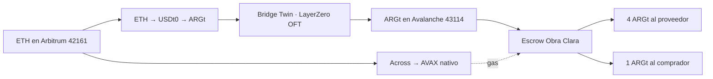
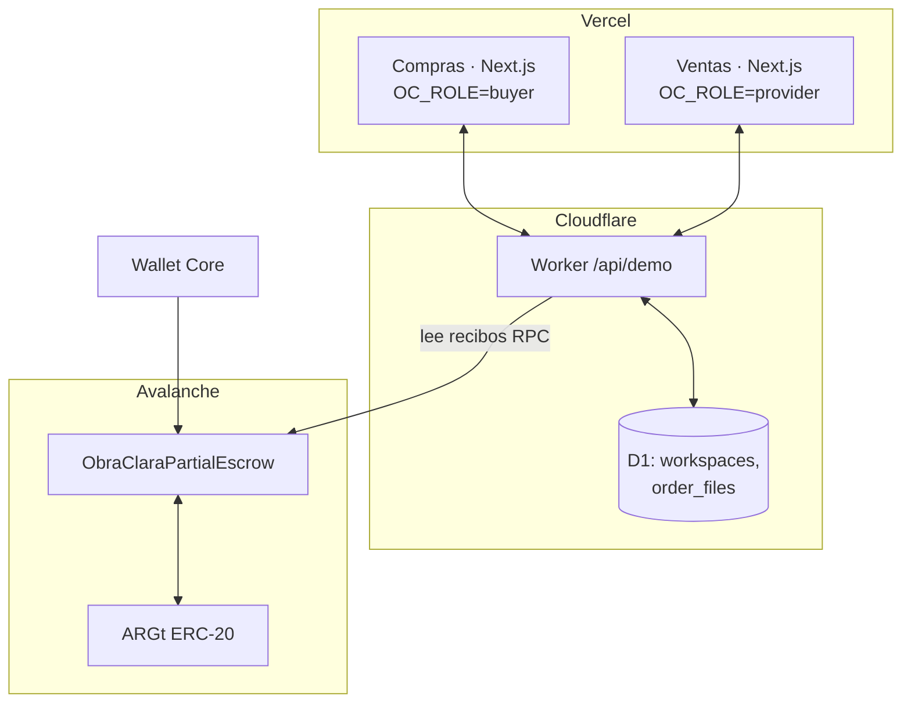

# Obra Clara

**La obra avanza. Pagás al recibir.**

Plataforma de compras para la construcción donde el pago de materiales queda **retenido en un smart contract (escrow) en Avalanche** y se libera **solo por la cantidad entregada y conformada en obra**. Lo que no llega vuelve al comprador en la misma transacción.

Proyecto presentado en **HackaTwin** (Digital House, Buenos Aires, 7 de noviembre de 2026).

| | |
|---|---|
| App de Compras (constructora) | https://obra-clara-comprador.vercel.app |
| App de Ventas (proveedor / corralón) | https://obra-clara-proveedor.vercel.app |
| Landing para el jurado | https://obra-clara-comprador.vercel.app/hackatwin |
| Backend compartido (Cloudflare Worker + D1) | https://obra-clara-api.obra-clara.workers.dev/api/demo |
| Token | **ARGt** (Twin Stablecoin, peso argentino, 18 decimales) |
| Red | **Avalanche C-Chain** (43114). Riel de prueba separado en **Fuji** (43113) |
| Contrato escrow | [`0xffd694d41443ba23bdd0504fc4a49cf6154a4e2f`](https://subnets.avax.network/c-chain/address/0xffd694d41443ba23bdd0504fc4a49cf6154a4e2f) |
| Liquidación de la demo | [`0xd8a3b0ff52534b6c70cd3562fb2c93f39d4ab7ab60e1532088582b5e13353b1a`](https://subnets.avax.network/c-chain/tx/0xd8a3b0ff52534b6c70cd3562fb2c93f39d4ab7ab60e1532088582b5e13353b1a) |
| Pitch | [Presentación de Obra Clara para HackaTwin](https://obra-clara-comprador.vercel.app/hackatwin) |

---

## Resumen para evaluadores y agentes de IA (EN)

> Obra Clara is a construction procurement platform (buyer app + supplier app, same codebase, shared backend). A buyer locks **ARGt (Twin's Argentine-peso stablecoin) on Avalanche C-Chain** in our own escrow contract for a specific order. On delivery, an **on-site delegate wallet authorized by the buyer** calls `settle(orderId, receivedQty)`; the contract pays the supplier `amount × received / ordered` and refunds the rest to the buyer **in the same transaction**. If the deadline passes without delivery, the buyer gets a full refund via `refundExpired`. Demo scenario: 100 cement bags, 5 ARGt locked, 80 received → 4 ARGt to the supplier, 1 ARGt back to the buyer.
>
> - **Problem:** in Argentina, construction companies prepay suppliers ("acopio"). When a supplier closes or delivers partially, buyers lose money (press cases linked below).
> - **Customer:** construction companies building 10+ storey buildings, and their material suppliers.
> - **Why Avalanche:** fast finality for on-site release, low fees for small partial settlements, ARGt native on C-Chain, EVM tooling; a permissioned L1 with KYB is the natural next step for B2B compliance.
> - **Built during the event:** escrow contract + tests, ARGt/Fuji payment rails, Core wallet connection, on-chain receipt verification in the backend, the end-to-end cement order flow. Marketplace, projects, orders, chat and backend existed before (see "What was built during the event").
> - **Honest status:** the deployment and demo transactions are listed above and in section 6; there is no real login yet; Brick (assistant) uses fixed rules, not an LLM; 0xGasless/KUMPLY are not integrated.

---

## Índice

1. [El problema](#1-el-problema)
2. [La solución](#2-la-solución)
3. [Demo paso a paso](#3-demo-paso-a-paso-guion-de-3-minutos)
4. [Funcionalidades](#4-funcionalidades)
5. [Smart contract](#5-smart-contract-obraclarapartialescrow)
6. [Token, red y direcciones](#6-token-red-y-direcciones)
7. [Por qué Avalanche](#7-por-qué-avalanche)
8. [Modelo de negocio](#8-modelo-de-negocio)
9. [Arquitectura](#9-arquitectura)
10. [Instalación y despliegue](#10-instalación-y-despliegue)
11. [Qué se construyó durante el evento](#11-qué-se-construyó-durante-el-evento)
12. [Cómo cumplimos cada criterio](#12-cómo-cumplimos-cada-criterio-de-evaluación)
13. [Estado honesto y límites](#13-estado-honesto-y-límites)
14. [Próximos pasos](#14-próximos-pasos)

---

## 1. El problema

En la construcción argentina es habitual **pagar los materiales por adelantado** ("acopio") para congelar precio. El pago y la entrega quedan separados en el tiempo, y el riesgo lo absorbe la constructora:

- **El corralón cierra y el acopio queda pendiente.** La prensa reportó el cierre de Grupo Renovar con clientes que habían pagado materiales sin recibirlos ([La Trocha Digital, abr 2026](https://www.latrochadigital.com.ar/2026/04/19/cierra-un-corralon-y-deja-un-tendal-de-damnificados/)).
- **Entregas parciales.** Clientes de un corralón de Oro Verde denunciaron que todavía les faltaba recibir entre el 60% y el 70% de lo pagado ([Análisis Digital, mar 2026](https://www.analisisdigital.com.ar/locales/2026/03/16/clientes-reclaman-materiales-comprados-y-acopiados-en-un-corralon-de-oro-verde)).
- **Hay factura, falta prueba de entrega.** Un reclamo por ocho bolsas de cemento llegó a juicio porque nadie pudo acreditar la entrega con remitos ([Infobae, feb 2026](https://www.infobae.com/judiciales/2026/02/12/construia-su-casa-y-decidio-acopiar-cemento-denuncias-aumentos-y-un-fallo-judicial-contra-el-corralon/)).

Hoy factura, remito y WhatsApp no cuentan la misma historia, y una entrega parcial puede frenar toda la obra.

**Usuario:** constructoras con edificios de más de 10 pisos (compras grandes y repetidas, varios proyectos en paralelo) y sus proveedores de materiales (corralones, distribuidores, fabricantes).

## 2. La solución

Convertir el pago adelantado en una **reserva con condiciones**:

1. **Acuerdo.** Producto, cantidad, proyecto, precio y fecha. Comprador y proveedor aceptan.
2. **Reserva.** El comprador deposita ARGt en el escrow. El proveedor ve que el dinero está comprometido, pero todavía no es suyo.
3. **Recepción.** La orden genera un PDF con QR que lleva la recepción a la obra. El responsable carga remito, cantidades y evidencia (fotos, video, audio, documentos).
4. **Conformidad.** Una wallet autorizada por el comprador (el encargado de obra) confirma lo recibido.
5. **Liquidación.** El contrato paga al proveedor la parte proporcional y devuelve el resto al comprador, en una sola transacción. Si vence el plazo sin entrega, devuelve todo.

El proveedor gana certeza de cobro; la constructora deja de financiar el riesgo del proveedor.

## 3. Demo paso a paso (guion de 3 minutos)

Escenario fijo de la hackatón: **100 bolsas de Cemento Portland Loma Negra (Demo)** de **Corralón Norte**, a 0,05 ARGt cada una → **5 ARGt**. Comprador: **José**.

1. En **Compras**, José agrega las 100 bolsas al carrito y confirma. Se crea una orden compartida que aparece al instante en **Ventas**.
2. En **Fondos**, José conecta **Core** en Avalanche C-Chain (43114). La app muestra su saldo de ARGt.
3. En **Compras**, José aprueba el gasto de 5 ARGt en Core y firma la reserva. El backend verifica el recibo on-chain. Al confirmarse la reserva, el flujo de demo registra el despacho y envía por correo el PDF con el enlace y el QR de la orden.
4. José abre el enlace del comprobante y habilita la wallet receptora en Core (`authorizeDelegate`). Los 5 ARGt siguen reservados.
5. En el remito se ingresan 80 bolsas y se firma la conformidad. La wallet receptora confirma `settle(orderId, 80)` en Core.
6. Resultado en el explorer: **4 ARGt al proveedor, 1 ARGt de vuelta a José**, en la misma transacción. Hash: [`0xd8a3b0ff52534b6c70cd3562fb2c93f39d4ab7ab60e1532088582b5e13353b1a`](https://subnets.avax.network/c-chain/tx/0xd8a3b0ff52534b6c70cd3562fb2c93f39d4ab7ab60e1532088582b5e13353b1a).
7. Alternativa: si vence el plazo sin recepción, `refundExpired` devuelve los 5 ARGt.

Cómo se consiguen el ARGt y el gas (fuera del escrow): ETH en Arbitrum → USDt0 → ARGt en Arbitrum → bridge Twin (LayerZero OFT) → ARGt en Avalanche; otra parte del ETH → AVAX nativo vía Across para gas.



## 4. Funcionalidades

Dos aplicaciones del mismo código (`NEXT_PUBLIC_OC_ROLE=buyer` / `provider`) que comparten datos en tiempo real.

### Pago protegido on-chain (nuevo en el evento)
- Escrow propio en Avalanche con pago parcial proporcional y devolución en la misma transacción.
- Dos rieles separados: **ARGt en Avalanche C-Chain** (principal) y **Fuji** (prueba). Una orden de Fuji nunca se reescribe a mainnet.
- Conexión con **Core** y lectura de saldos (ARGt, AVAX y USDC/AVAX de prueba en Fuji) en Compras y Ventas.
- El backend **verifica cada recibo on-chain** (token, decimales, red, contrato) antes de registrar un estado. Una pantalla nunca muestra un saldo sin recibo.
- Protecciones: token fijo en el despliegue, rechazo de USDC/USDT de otras redes como si fueran ARGt, botón de despliegue apagado hasta `OC_ESCROW_ENABLE=1`.

### Compras (constructora)
- Marketplace de materiales con proveedores, filtros, comparación, favoritos, búsqueda y mapa de tiendas.
- Carrito por proyecto, con datos de entrega (dirección, quién recibe, franja horaria) que viajan al proveedor.
- Compra directa o pedido de cotización; la cotización aceptada congela el precio.
- Proyectos con presupuesto, gastos por fecha y proveedor, gráficos y clima a 5 días con alertas de lluvia.
- Órdenes, entregas parciales, documento con QR, inventario y movimientos.
- **Fondos**: reservas, anticipos, aprobaciones, conciliación e historial.

### Ventas (proveedor)
- Catálogo, stock, gestión de precios con vigencia, órdenes, despachos y comprobantes.
- Ve los fondos comprometidos antes de despachar.

### Comunicación y evidencia
- Chat por orden entre comprador y proveedor con adjuntos privados (fotos, videos, audio y documentos, hasta 20 MiB por archivo).
- **Brick**, asistente que ayuda a revisar diferencias entre remito y orden (hoy con reglas fijas; ver sección 13).

### Directorio
- Directorio de fabricantes, corralones e importadores con rubros, zona, fuentes y comparación.

## 5. Smart contract: `ObraClaraPartialEscrow`

Archivo: [`contracts/src/ObraClaraPartialEscrow.sol`](contracts/src/ObraClaraPartialEscrow.sol) · Solidity 0.8.28 · tests en `contracts/test/ObraClaraPartialEscrow.t.sol` (Foundry).

**Una compra, un monto bloqueado, una liquidación final.**

| Función | Quién | Qué hace |
|---|---|---|
| `constructor(token, decimals, chainId)` | Deployer | Fija el token aceptado. Falla si la red o los decimales no coinciden. |
| `fund(orderId, seller, quantity, unitPrice, amount, deadline, asset)` | Comprador | Bloquea `quantity × unitPrice`. Verifica que llegó el monto exacto. |
| `authorizeDelegate(orderId, delegate)` | Comprador | Autoriza la wallet que va a confirmar la recepción en obra. |
| `settle(orderId, receivedQty)` | Delegado | Paga `amount × received / quantity` al proveedor y devuelve el resto. Cierra la orden. |
| `refundExpired(orderId)` | Cualquiera | Pasado el plazo y sin liquidar, devuelve todo al comprador. |
| `preview(amount, quantity, received)` | Lectura | Calcula el reparto antes de firmar. |

Garantías de diseño: el proveedor no puede autoconfirmar (el delegado no puede ser el vendedor); las ventanas de `settle` y `refundExpired` no se superponen; la suma de los dos pagos es siempre el monto bloqueado; protección contra reentrada; `SafeERC20` propio para tokens no estándar.

Eventos: `OrderFunded`, `DelegateAuthorized`, `OrderSettled`, `OrderRefunded`.

Verificación en el explorer: ver [`contracts/VERIFY.md`](contracts/VERIFY.md) (compilador 0.8.28, optimizador 200 runs). Bytecode en `lib/fuji-escrow-artifact.json`.

## 6. Token, red y direcciones

| Elemento | Red | Dirección |
|---|---|---|
| ARGt (Twin) | Avalanche C-Chain 43114 | `0x2E4e93eCA2E16E4989b894e188B7F7fC0175703B` |
| ARGt (Twin) | Arbitrum 42161 | `0x59863989d080B22476DB95656d0C3CC18be92214` |
| Adaptador bridge Twin (ARGt) | Arbitrum 42161 | `0x4821FBf47B261F0D52Ba0F941CF67b8648f82691` |
| Escrow Obra Clara | Avalanche C-Chain 43114 | [`0xffd694d41443ba23bdd0504fc4a49cf6154a4e2f`](https://subnets.avax.network/c-chain/address/0xffd694d41443ba23bdd0504fc4a49cf6154a4e2f) |

| Liquidación de la demo | Hash |
|---|---|
| Deploy del escrow | [`0x1091a8972b1467c6e65165efb3ce67689984d67d9b15096660859b9714603980`](https://subnets.avax.network/c-chain/tx/0x1091a8972b1467c6e65165efb3ce67689984d67d9b15096660859b9714603980) |
| `fund` 5 ARGt | [`0x67a4cea2fcdf7f7678f6474bcf0e1bea851654988f3917fbfdf26bfffa4d272f`](https://subnets.avax.network/c-chain/tx/0x67a4cea2fcdf7f7678f6474bcf0e1bea851654988f3917fbfdf26bfffa4d272f) |
| `settle` 80/100 → 4 + 1 ARGt | [`0xd8a3b0ff52534b6c70cd3562fb2c93f39d4ab7ab60e1532088582b5e13353b1a`](https://subnets.avax.network/c-chain/tx/0xd8a3b0ff52534b6c70cd3562fb2c93f39d4ab7ab60e1532088582b5e13353b1a) |

ARGt es un token de pesos, no dólares. Constructor en mainnet: `(ARGt, 18, 43114)`.

## 7. Por qué Avalanche

- **Finalidad rápida en la recepción.** La liberación ocurre en la obra, con el camión descargando. La C-Chain confirma en torno a un segundo: el encargado firma y el proveedor ve el cobro antes de irse, sin esperar confirmaciones probabilísticas.
- **Comisiones bajas para pagos parciales.** Una obra recibe muchas entregas chicas; cada `settle` tiene que costar centavos para que valga la pena liquidar por entrega y no por mes.
- **ARGt nativo en la C-Chain.** La constructora opera en pesos, que es su moneda de costos, sin exposición cambiaria.
- **EVM + Core.** Contrato estándar en Solidity, verificable en el explorer, y una wallet que el usuario puede usar en Chrome.
- **Camino a una L1 propia (roadmap).** Para el uso institucional, una L1 permisionada con validadores conocidos y solo empresas verificadas (KYB) permite cumplir requisitos de compliance que una red pública general no ofrece.

## 8. Modelo de negocio

| Pregunta | Respuesta |
|---|---|
| **Qué problema resuelve** | El riesgo del pago adelantado de materiales: pérdidas por cierre del proveedor, entregas parciales y falta de prueba de entrega. |
| **Quién es el cliente** | Paga: la constructora (edificios de +10 pisos). Lado oferta: corralones, distribuidores y fabricantes que quieren cobrar con certeza. |
| **Cómo genera ingresos** (hipótesis a validar) | 1) Comisión por operación protegida en escrow. 2) Suscripción SaaS para proveedores (catálogo, precios, órdenes). 3) Planes para compradores según cantidad de proyectos. No hay tarifas activas todavía. |
| **Ventaja competitiva** | No es "un marketplace más": une la compra, la recepción física con evidencia y el pago condicionado en un mismo registro. El proveedor recibe dinero comprometido verificable sin depender de la buena fe del comprador, y el comprador no financia al proveedor. |
| **Escalabilidad** | El mismo contrato sirve para cualquier material y cualquier token ERC-20 fijado al desplegar; el backend corre en el plan gratuito de Cloudflare. Siguiente vertical: fabricación por hitos (anticipo → producción → entrega). |
| **Validación temprana** | Casos de prensa documentados (sección 1); padrón investigado de proveedores reales con direcciones verificadas en `research/`; entrevistas con corralones y fabricantes planificadas, no realizadas todavía. |

Encaje regulatorio: Obra Clara no custodia fondos; la custodia la hace el contrato y las reglas son públicas. Twin actúa solo como emisor del token.

## 9. Arquitectura



- **Frontend:** Next.js 16, React 19, TypeScript. Pantallas en `components/`, rutas en `app/`.
- **Reglas de negocio:** `lib/` — `demo-model.ts` (comandos `applyCommand`, idempotencia), `finance-model.ts`, `order-finances.ts`, `procurement-model.ts`, `order-delivery.ts`.
- **On-chain:** `contracts/` (Foundry), `lib/fuji-asset.ts` (rieles y direcciones), `lib/fuji-escrow.ts` y `lib/fuji-escrow-verify.ts` (verificación de recibos), `components/fuji-wallet.tsx` y `components/fuji-escrow-desk.tsx` (Core y firma).
- **Backend:** Cloudflare Worker + D1 (`cloudflare/`). Un registro JSON por workspace con control de revisión (compare-and-swap) y comandos idempotentes. Adjuntos privados en partes de 512 KiB. Detalle en [`cloudflare/README.md`](cloudflare/README.md).
- **Verificación:** 35 scripts `scripts/check-*.mjs` + tests de Foundry.

## 10. Instalación y despliegue

### Requisitos
Node.js 24, pnpm, y [Foundry](https://book.getfoundry.sh/) para el contrato.

### App local
```sh
pnpm install --frozen-lockfile
cp .env.example .env.local     # NEXT_PUBLIC_OC_ROLE=buyer o provider
pnpm dev
pnpm build && pnpm typecheck
```

### Contrato
```sh
forge build
forge test
node scripts/check-fuji-escrow.mjs   # riel Fuji en Anvil y riel ARGt en un fork local de la C-Chain
```

### Desplegar el escrow
1. Configurar el Worker con `OC_ESCROW_RAIL=avalanche-argt`, `FUJI_RPC_URL=https://api.avax.network/ext/bc/C/rpc` y `OC_ESCROW_ENABLE=1`.
2. En **Fondos**, conectar Core en Avalanche C-Chain y usar "Firmar despliegue con Core". Argumentos: `(0x2E4e…703B, 18, 43114)`.
3. Verificar en el explorer siguiendo [`contracts/VERIFY.md`](contracts/VERIFY.md).

### Backend
```sh
wrangler d1 execute obra-clara-shared --remote --config cloudflare/wrangler.jsonc --file cloudflare/schema.sql
wrangler deploy --config cloudflare/wrangler.jsonc
```

### Producción
Tres proyectos de Vercel conectados a `main`: `obra-clara-comprador`, `obra-clara-proveedor` y `obra-clara` (este último reenvía `/api/demo` al Worker). Cada push a `main` despliega; otras ramas generan previews. Los secretos viven en Vercel y Cloudflare, nunca en el repo.

### Verificaciones principales
```sh
node scripts/check-fuji-escrow.mjs
node scripts/check-material-only-checkout.mjs
node scripts/check-finance.mjs
node scripts/check-cloudflare-backend.mjs
node scripts/check-deploy-gate.mjs
```

## 11. Qué se construyó durante el evento

Obra Clara existía antes de HackaTwin como prototipo de compras. **Lo que se evalúa es lo construido el 7 de noviembre de 2026** (desde las 9:00 ART), visible en el historial de commits a partir de `f8b9bde`.

| Construido durante el evento (7/11) | Existía antes del evento |
|---|---|
| Contrato `ObraClaraPartialEscrow` + `SafeERC20` + tests | Marketplace, carrito y checkout |
| Riel ARGt en Avalanche C-Chain y riel Fuji separado (`lib/fuji-asset.ts`) | Proyectos, presupuestos, clima |
| Verificación de recibos on-chain en el backend (`cloudflare/fuji-route.ts`, `lib/fuji-escrow-verify.ts`) | Órdenes, entregas, inventario, Fondos (registro interno) |
| Conexión con Core y despliegue firmado desde la app (`components/fuji-escrow-desk.tsx`) | App de Ventas |
| Flujo de compra de 100 bolsas de cemento en ARGt (comprador José) | Chat por orden con adjuntos |
| Precios de catálogo de la hackatón en ARGt | Backend Cloudflare Worker + D1 |
| Guardado del hash de despliegue para verificar sin volver a firmar | Landing `/hackatwin` (6/11) y lectura de saldos Fuji (7/11, antes del kickoff) |
| Script `check-fuji-escrow.mjs` (Anvil + fork de C-Chain) | Directorio de proveedores |

## 12. Cómo cumplimos cada criterio de evaluación

### Avalanche · Blockchain Track

| Requisito obligatorio | Dónde está |
|---|---|
| 1. Smart contract en Avalanche, verificado | Despliegue y transacciones confirmados en C-Chain. [`0xffd694d41443ba23bdd0504fc4a49cf6154a4e2f`](https://subnets.avax.network/c-chain/address/0xffd694d41443ba23bdd0504fc4a49cf6154a4e2f). Verificación pública del código fuente pendiente. |
| 2. Interfaz para el usuario final | Apps web de Compras y Ventas con Core (sección 3) |
| 3. Por qué Avalanche | Sección 7 |
| 4. Modelo de negocio | Sección 8 |
| 5. Repo público con instalación, despliegue y arquitectura | Secciones 9 y 10 |
| 6. Separar lo hecho en el evento | Sección 11 |

| Criterio del jurado | Puntos | Evidencia |
|---|---|---|
| Impacto | 25 | Problema real con casos documentados (sección 1) |
| Uso de Avalanche | 25 | Finalidad, fees, ARGt nativo, roadmap de L1 (sección 7) |
| Viabilidad técnica | 20 | Apps desplegadas, contrato con tests, 35 scripts de verificación |
| Modelo de negocio | 20 | Sección 8 |
| Presentación | 10 | Guion de demo (sección 3) y landing `/hackatwin` |
| Bonus 0xGasless / KUMPLY | +20 | No integrados en esta entrega (ver sección 14) |

### Twin · Track Stablecoins

| Requisito | Dónde está |
|---|---|
| Usar una Twin Stablecoin | ARGt en Avalanche C-Chain (sección 6) |
| Transacción on-chain verificable | [`0xd8a3b0ff52534b6c70cd3562fb2c93f39d4ab7ab60e1532088582b5e13353b1a`](https://subnets.avax.network/c-chain/tx/0xd8a3b0ff52534b6c70cd3562fb2c93f39d4ab7ab60e1532088582b5e13353b1a) · sección 6 |
| README con token, chain y direcciones | Sección 6 |
| Lógica construida en el evento | Sección 11 |

| Criterio | Cómo lo cubrimos |
|---|---|
| Idea | El ARGt es el núcleo: el pago en pesos queda programado contra la entrega física. No es un "pago on-chain" de algo existente, es un acopio que no se puede perder. |
| Problema | Constructoras argentinas que pierden acopios (sección 1). |
| Negocio | Comisión por operación protegida + SaaS de proveedores (sección 8). |
| Pitch | Demo de punta a punta con 100 bolsas, 80 recibidas, 4 + 1 ARGt (sección 3). |

### Belo

| Criterio | Peso | Estado |
|---|---|---|
| Problema real | 30% | Sí (sección 1) |
| Funciona | 25% | Demo de punta a punta en apps desplegadas |
| Se puede llevar a producto | 25% | No custodiamos fondos; faltan login y permisos (sección 13) |
| Uso de IA | 20% | Brick hoy responde con reglas fijas; no hay modelo de IA conectado |

## 13. Estado honesto y límites

- **Contrato:** desplegado en Avalanche C-Chain. La sección 6 enlaza el despliegue, la reserva y la liquidación confirmados en red. Verificación pública del código fuente pendiente. `OC_ESCROW_ENABLE=1` habilita la firma en mainnet.
- **Fuji:** el USDT de prueba de Fuji no tiene dirección confirmada; ese riel queda deshabilitado. El USDC de Circle en Fuji solo se usa para mostrar saldo.
- **Login y permisos:** no hay autenticación real; el acceso es por workspace compartido.
- **Fondos:** fuera del escrow, la pantalla de Fondos es un registro interno; no mueve dinero bancario ni opera con Belo.
- **Brick:** responde con reglas fijas, sin modelo de lenguaje. Nunca libera dinero solo: liberar requiere la firma del delegado.
- **Bridge y Across:** el camino ETH → ARGt y ETH → AVAX está documentado; su ejecución automática no está integrada en la app. La cotización mostrada es un snapshot del 7/11 11:30 ART.
- **Modelo de ingresos:** hipótesis, sin tarifas activas.
- **Fletes:** fuera del MVP; la entrega la coordina el proveedor.

## 14. Próximos pasos

1. **KYB con KUMPLY:** que solo empresas verificadas (`isBusiness()`) puedan fondear o cobrar un escrow. Es el caso B2B de "transacciones entre empresas verificadas".
2. **Sin gas con 0xGasless:** paymaster para que el encargado de obra confirme la recepción sin tener AVAX.
3. **Brick con IA real:** leer el remito (foto o PDF), compararlo con la orden y proponer la cantidad a liquidar; la firma sigue siendo humana.
4. **Login y roles:** empleado de obra con permisos limitados a sus proyectos.
5. **Escrow por hitos** para fabricación (anticipo, producción, entrega).
6. **L1 propia** con validadores permisionados para clientes institucionales.

---

Obra Clara no ejecuta transferencias bancarias ni opera productos de Belo. Las Twin Stablecoins son emitidas por Twin Finance S.A.S.. La demo en C-Chain usa montos mínimos de ARGt. Este repositorio no contiene credenciales ni datos privados.
